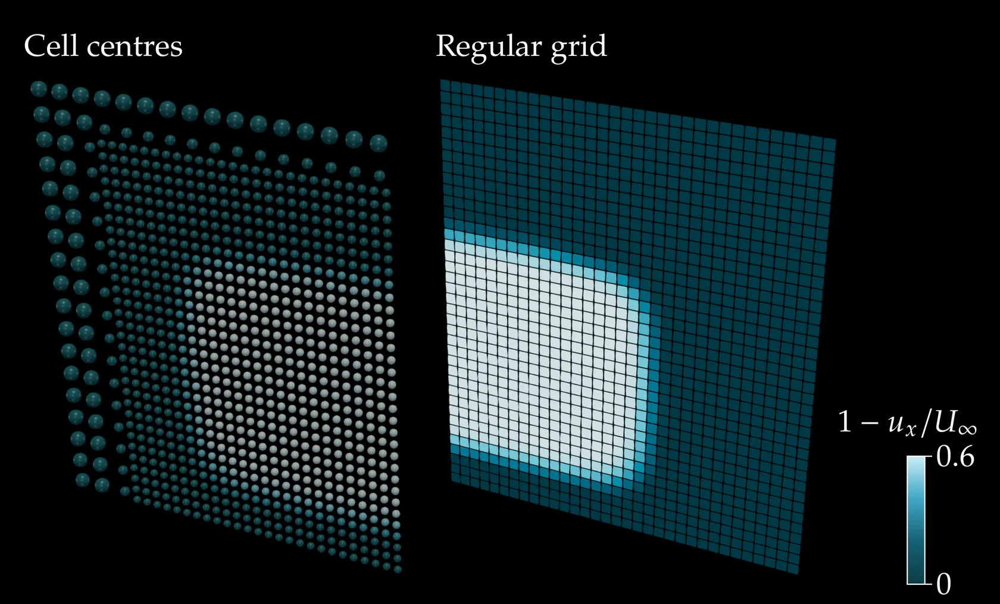

# OpenFOAM post-processing

**From OpenFOAM cell data to regular NumPy grids.**

<p align="center"></p>

Read OpenFOAM fields with [fluidfoam](https://fluidfoam.readthedocs.io/) and resample them onto regular arrays with local radial-basis interpolation, ready for profiles and planar sections. A rotor-wake snapshot is included; no OpenFOAM installation is needed to read it.

## Get started

```bash
git clone https://github.com/EngFlavioMartins/openfoam-postprocessing.git
cd openfoam-postprocessing
pip install -r requirements.txt
python examples/plot_sample.py
```

This plots one plane of the bundled snapshot to `outputs/sample.svg`. The notebooks [Creating_Backups.ipynb](Creating_Backups.ipynb) and [Examples.ipynb](Examples.ipynb) show the full workflow.

## Make the figure above

```bash
sh scripts/render/make_figure.sh
```

You need [ParaView](https://www.paraview.org/download/) (for `pvpython`), a LaTeX installation, and `pip install pyvista pillow`.

## Cite

The bundled data comes from the work below. If you use the data or this workflow, please cite:

```bibtex
@article{martins2025multirotor,
  author  = {Martins, Flavio A. C. and van Zuijlen, A. and Ferreira, C. S.},
  title   = {Proof of Concept for Multirotor Systems with Vortex-Generating Modes for Regenerative Wind Energy: A Study Based on Numerical Simulations and Experimental Data},
  journal = {Wind Energy Science},
  volume  = {10},
  pages   = {41--58},
  year    = {2025},
  doi     = {10.5194/wes-10-41-2025}
}
```

GitHub's **Cite this repository** button (from [CITATION.cff](CITATION.cff)) gives the same reference in other formats.

## Licence

MIT; see [LICENSE](LICENSE).
